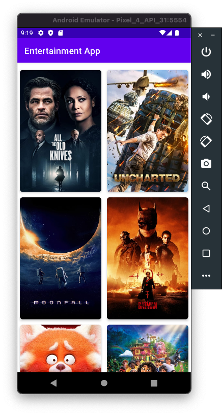

# Android Testing

A reference Android project for testing. It applies the official Android testing guidance to a small
movie app (TMDb API, Room, Compose and Views) and keeps every test layer runnable.

<p align="center">
  
</p>

## Modules

| Module | Purpose |
|---|---|
| `app` | UI (Compose and Views), DI wiring and app-level tests |
| `core` | Domain, repositories, Room and network data sources |
| `shared-test` | Fakes, test data, JUnit rules and fixtures shared by the other modules |

## Setup

The app reads the TMDb API key from `local.properties` (never commit it):

```properties
apiKey={your-api-key}
```

A real key is required for access to the TMDb API. For local tests, `NO_API_KEY` can be used as a
placeholder; tests never call the real API.

CI appends the `APIKEY` repository secret to its ephemeral `local.properties`. When the secret is
unavailable, such as on a fork pull request, CI uses `NO_API_KEY` for tests only.

## Running tests

| Goal | Command |
|---|---|
| Local unit tests and lint | `./gradlew test lint` |
| Instrumented tests on a connected device or emulator | `./gradlew connectedDebugAndroidTest` |
| Instrumented tests on a Gradle-managed device | `./gradlew pixel9api35DebugAndroidTest` |
| Coverage regression check (unit) | `./gradlew createDebugUnitTestCoverageReport coverageRegressionCheck -PcoverageKinds=test` |

See [docs/testing.md](docs/testing.md) for the test layers, conventions, coverage and CI.

## References

- [Testing strategies](https://developer.android.com/training/testing/fundamentals/strategies)
- [What to test](https://developer.android.com/training/testing/fundamentals/what-to-test)
- [Guide to app architecture](https://developer.android.com/jetpack/guide)
- [TMDb API documentation](https://www.themoviedb.org/documentation/api)
